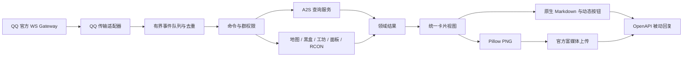

# 架构与 API 约定

## 目标数据流



已实现 QQ Token / REST、WS 读取与心跳重连、群隔离、有界 worker 队列、去重、真实 A2S、地图名称、黑盒语音、Steam 工坊、原生 Markdown 与可选 PNG 被动回复。用户已在真实群确认服务器真名和实时数据正常。run 不再提供模拟数据参数；fixture 仅供本地 demo / preview 与测试。RCON / 面板管理仍待实现。

## 模块边界

```text
src/l4d2_qq_bot/
  cli.py                 # validate / preview / demo / query / discover / run
  config.py              # 环境变量与业务配置
  domain.py              # Player / ServerStatus / Card
  commands.py            # 纯解析，群内名称匹配
  demo.py                # 明确标记的模拟事件验收
  services/query.py      # 地址解析、超时、A2S
  services/queries.py    # A2S 与地图 / 语音查询编排
  cards/views.py         # 结果转卡片，不访问网络
  cards/markdown.py      # 原生正文、文本转义、长度限制
  cards/renderer.py      # PNG 渲染、字体、截断
  qq/protocol.py         # 网关 opcode、会话状态
  qq/client.py           # Token、REST、PNG 上传、群发送
  qq/gateway.py          # WS 读取、心跳、恢复与退避重连
  qq/replies.py          # msg_id / msg_seq、回复预算、按钮
  qq/discovery.py        # 私人 OpenID 发现记录
  runtime.py             # HTTP / WS / worker 生命周期
  integrations/http.py   # 独立外部会话、响应上限、超时、并发
  integrations/cache.py  # TTL / LRU、合并并发请求、显式关闭
  integrations/maps.py   # 地图代码转真名
  integrations/heybox.py # 黑盒真实人数、名单与昵称缓存
  integrations/workshop.py # Steam 官方与原项目兼容解析 API
tests/                   # 离线测试
examples/                # 模拟群事件与配置说明
```

`app.py` 编排事件、命令、服务与回复；网关用非阻塞入队，队列满时保留上一序号并重连补发；业务处理与心跳分离。绘图在有锁的工作线程中执行。去重缓存最多 4096 项 / 10 分钟，队列默认 100 项、2 个 worker。原生模式不初始化 Pillow 字体。不要让 Pillow、QQ payload 或 AstrBot 类型进入 A2S 业务模型。

## QQ 官方协议

核对时间：2026-10-15。默认仅启用 `GROUP_AND_C2C_EVENT = 1 << 25` 中的群 @ 事件处理，其他场景后续明确接入，不共享群配置猜测用户身份。

- Token：POST `https://api.bot.qq.com/app/getAppAccessToken`，提交 appId / clientSecret；HTTP 200 也必须检查业务 code。使用返回的 expires_in，临过期刷新且串行合并刷新请求。
- REST：`Authorization: QQBot {access_token}`；GET `/gateway` 获取 WS URL，不硬编码旧 WSS 地址。
- WS：Hello(10) → Identify(2) → READY；Heartbeat(1) / ACK(11)；重连优先 Resume(6)，Reconnect(7) 重连，Invalid Session(9) 清理后重新鉴权。心跳携带最新 s，业务不得阻塞读取 ACK。
- 群事件：原始消息 ID 在 d.id；群为 d.group_openid；用户为 d.author.member_openid。顶层事件 id 不等同于被动回复的消息 id。
- 默认卡片：同一次 POST `/messages` 提交 `msg_type=2`、markdown.content 和 keyboard.content；不填写普通 content，不拆成图片和另一条消息。
- 图片：POST `/v2/groups/{group_openid}/files`，`srv_send_msg=false`；返回 file_info 后 POST `/messages`，`msg_type=7`、media.file_info、msg_id、msg_seq。
- 最新上传文档允许小文件 file_data（5M 以下），大文件走 upload_prepare → 预签名 PUT → upload_part_finish → files 合并；小 PNG 直接上传已通过真实应用群测，仅用于可选图片模式。
- 被动回复有时效及次数限制。ReplySession 对同一消息分配递增 msg_seq、最多 5 次发送；文本按 UTF-8 字节切分，业务从入队起默认最多处理 120 秒；不会无限叠加等待提示和补充地址。网络不确定的发送不会盲目重试，明确 401 / 429 拒绝才有限重试。

默认使用 `L4D2_REPLY_FORMAT=markdown`、`L4D2_CONNECT_BUTTONS=true`。官方 2026-04-23 更新已对群聊 / 单聊开放自定义 Markdown，按钮仍有独立权限限制；当前测试应用已在真实群验证原生卡片底部显示按钮。使用 `keyboard.content.rows[].buttons[]`，跳转按钮 `action.type=0`、`action.data` 为该服务器的 HTTPS 连接 URL。普通按钮模板不能动态替换 URL，本实现不使用固定模板。

按钮目标优先取 `servers[].connect_url`，其次按 `connect_base_url + '/' + address` 生成。例如基础地址 `https://steam-connect.laoyutang.cn` 和服务器 `106.54.214.111:37015` 组成完整连接页 URL。目标与本次查询结果一起构造，多人并发不共享“当前服务器”。无 URL 时提供 `action.type=2` 的填入指令按钮，enter=false，明确标注用途。每个按钮文字最多 10 字符。

原生 Markdown 复用视图层脱敏，正文限制 3200 UTF-8 字节。圆括号直接保留，避免 `\(...\)` 被 QQ 解释成公式；方括号用字符实体，避免生成公式或注入链接。单服标题来自真实 server_name，配置 name 仅为快捷名。单服卡片不显示“已脱敏”、connect 指令与查询时间，正常情况下仅挂载“进入服务器”按钮。明确的按钮权限 / URL 拒绝会说明原因并补回连接指令；明确的 Markdown 权限拒绝再回退文字。始终保留被动 msg_id，使用新 msg_seq；超时或结果不确定时不重发。

官方 SDK 旧公告表示 WS 曾计划下线，但现行文档仍提供 WS 接入。两者并存意味着必须核实具体应用的实际权限；不能仅凭文档断言“所有新机器人都能用 WS”，也不能忽略用户要求改走其他链路。

## 数据与外部调用

`players=None` 表示尚未查询或获取失败；空 tuple 表示已确认零玩家。玩家数始终采用 INFO 报告，不能用 PLAYER 名单长度替代。名字在视图层清理和脱敏，原始结果不写入日志。

本地 `query` 在 DNS 解析后检查目标地址并使用解析出的 IP 发 UDP，请求全程有超时；未经显式允许不访问本机 / 私网。群机器人允许配置中可信地址走私网，临时查询继续遵守公网限制。

地图查询保留上游 GET `map_name_url/map_code` 纯文本协议，成功结果缓存 1 小时，并发同图合并。失败返回 A2S 实际地图代码，不生成猜测名称。

外部 API 与 QQ 使用独立 ClientSession，外部请求并发默认 4、单次超时 5 秒、响应最多 1 MiB，拒绝重定向且不记录响应体。黑盒 Token 只通过请求级 token header 提供。人数使用每次频道查询的真实 user_ids；字段缺失是失败，不视作零人。房间昵称分页每页 100、最多 20 页，缓存 10 分钟；名单失败仍保留真实人数。语音失败不改变 A2S 的在线状态。

工坊默认请求 Steam GetPublishedFileDetails 和 GetCollectionDetails。真实详情响应可能给合集返回 file_url 且缺少类型字段，因此使用合集接口确认类型，不能根据 file_url 判断单品。合集默认最多取前 20 项，每页一项；私有 / 删除条目保留不可访问状态，空下载地址保留元信息。自定义 workshop_api_url 时兼容原项目 `POST [ID]` JSON 协议。工坊和下载链接只展示，不下载 / 安装文件。RCON 与面板操作未实现。

## 依据

- [参考项目](https://github.com/LaoYutang/l4d2-with-astrbot)（核对版本及 API 改写来源见 [NOTICE](../NOTICE.md)）
- [访问凭证](https://bot.q.qq.com/wiki/develop/api-v2/dev-prepare/access-token.html)
- [事件与 WebSocket](https://bot.q.qq.com/wiki/develop/api-v2/dev-prepare/interface-framework/event-emit.html)
- [群事件字段](https://bot.q.qq.com/wiki/develop/api-v2/autogen/event/group_at_message_create.html)
- [群富媒体上传](https://bot.q.qq.com/wiki/develop/api-v2/autogen/api/v2_groups_group_openid_files.post.html)
- [群消息发送](https://bot.q.qq.com/wiki/develop/api-v2/autogen/api/v2_groups_group_openid_messages.post.html)
- [原生按钮、自定义权限与跳转字段](https://bot.q.qq.com/wiki/develop/api-v2/server-inter/message/trans/msg-btn.html)
- [原生 Markdown 格式与 2026 能力开放说明](https://bot.q.qq.com/wiki/develop/api-v2/server-inter/message/type/markdown.html)
- [2026 API 域名变更](https://bot.q.qq.com/wiki/develop/api-v2/changelog.html)
- [官方 SDK 旧 WS 公告](https://github.com/tencent-connect/botgo#注意事项)
- [Steam 官方工坊详情与合集接口](https://partner.steamgames.com/doc/webapi/ISteamRemoteStorage)
